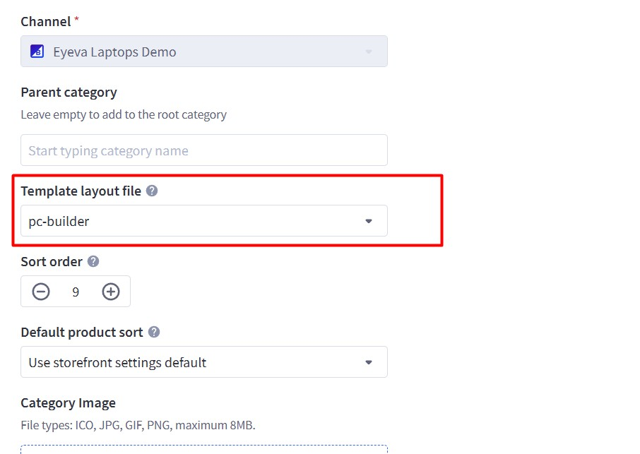
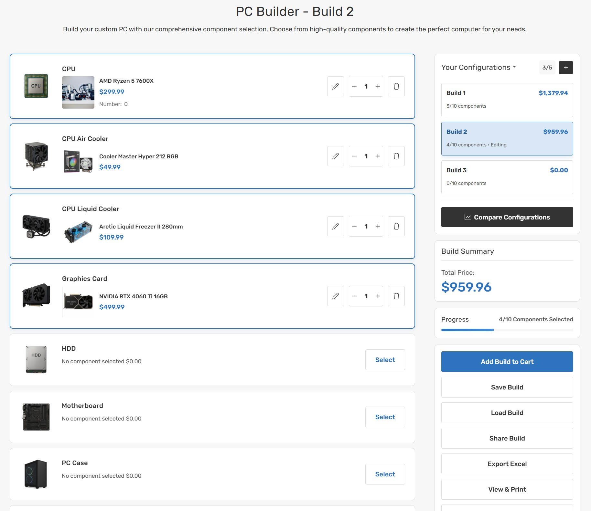
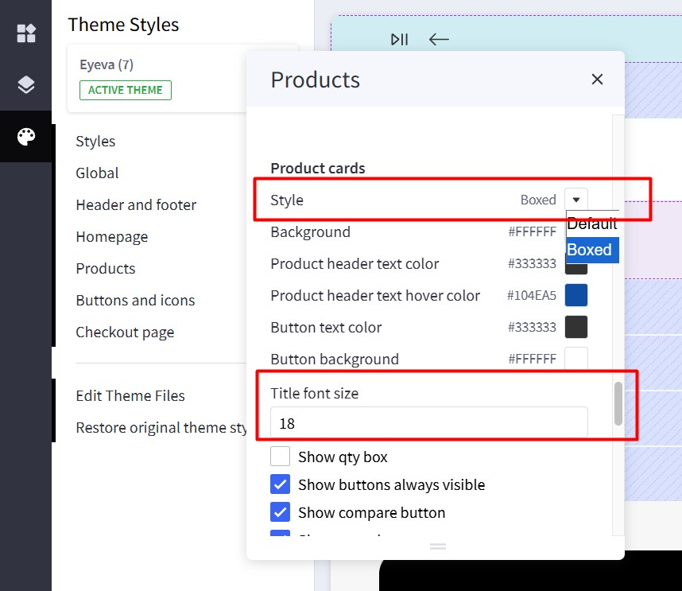
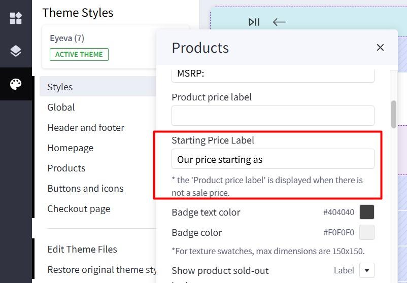
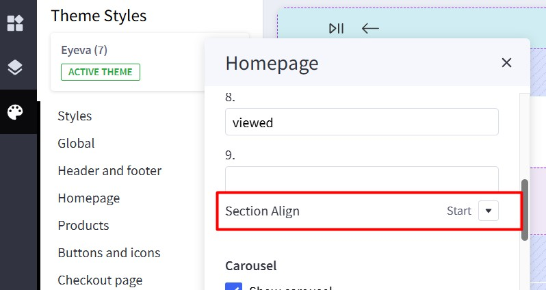
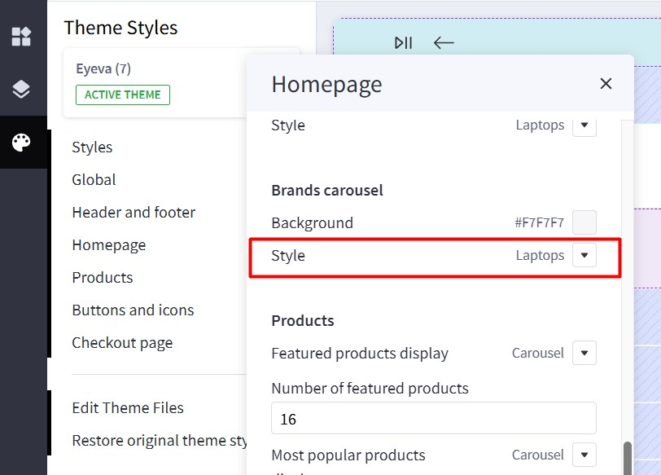

# Release Notes

## 1.4.1 (10-30-2026)
- Fix: The footer "Products" heading showed with nothing under it when the store had no categories to list; it now hides like the Brands heading, and widgets placed in that column stay (#129)
- Fix: With two or more top banners (Marketing > Banners), clicking the banner on screen opened the link of a hidden one, because the hidden banners sat on top of it (#128)
- Fix: Category Suggestions on the search page listed every ancestor as a suggestion of its own, so a parent repeated once per matching child; each suggestion is now one row carrying its whole path (#126)
- Theme Editor: optional headings for the homepage Featured, Most popular and New product sections; blank keeps the language-file text (#125)
- Selected product options share one colour, "Field border active": rectangle buttons are filled (text picked for contrast), swatches and pick list items get a 2px ring, on the product page and in the modifiers modal (#124)
- Fix: Swatches had no hover state on the product page or in the modifiers modal (#124)
- Fix: Keyboard focus on a swatch in the modifiers modal drew a row-wide ellipse (#124)
- Sofas variation: "Field border active" set to the olive brand colour, so selected options match the buttons (#124)
- Fix: Stray tax label ("(Ex. Tax)" / "(Inc. Tax)") rendered inside the hidden, empty price block, so crawlers read a tax-exclusive label next to a tax-inclusive price (#123)
- Expose `product_col_xl` (1441px and up) and `product_col_l` (1261px - 1440px) in the theme editor, and label each column setting with its screen size range (#121)
- Fix: GraphQL product cards (Recently Viewed, header recently viewed dropdown, guest wishlist, cart suggestions) threw an error and stayed on grey placeholders when the store currency came back empty, and showed random catalog products when there was nothing to show (first visit, empty wishlist) (#130)

## 1.4.0 (08-04-2026)
- Add Featured Promotions callouts on product cards and the product detail page, with a theme setting and editable colors (#118)
- Add backorder and stock messaging on the product detail page, cart, cart drawer, and account order details, including per-picklist-option backorder handling (#117)
- Fix: Shipping countdown no longer promises on-schedule shipping when the quantity exceeds ship-ready stock (#117)

## 1.3.4 (06-11-2026)
- Fix: Wishlist dropdown not opening on quick-search product cards
- Fix: AJAX add-to-cart click silently failing when href is empty

## 1.3.3 (04-24-2026)
- Fix: Swap content/data keys in onProductOptionsChanged event detail [bigcommerce/cornerstone#2640](https://github.com/bigcommerce/cornerstone/pull/2640)
- Add page transition overlay feature (#115)
- Fix: Swap content/data keys in onProductOptionsChanged event detail

## 1.3.2 (02-27-2026)
- Fix: Footer link color now respects theme style settings

## 1.3.1 (01-20-2026)
- Fix: Logo text color setting now correctly applies to logo text instead of using navUser-color

## 1.3.0 (12-12-2025)
- Fix: Prevent duplicate Add to Cart button for Pre-order products in Recently Viewed carousel
- feat: [Add keyword suggestions feature for quick search](./usage/keyword-suggestions.md) (#112)

<iframe width="560" height="315" src="https://www.youtube.com/embed/mMg9aPb5SJY" title="Quick Search - Keyword Suggestions" frameborder="0" allow="accelerometer; autoplay; clipboard-write; encrypted-media; gyroscope; picture-in-picture; web-share" allowfullscreen></iframe>

## 1.2.2 (10-03-2025)
- Fix currency symbol and add to cart url for product card rendered by graphql

## 1.2.1 (09-12-2025)
- Add theme settings: show custom fields on card.
- Add a section to display the payment promotion widget in the cart drawer.

## 1.2.0 (08-01-2025)
- Complete PC Builder Feature + Laptops Theme Variant Implementation (#108)

  

  

- Add card style options and header font settings in theme editor.

  

- Add custom fields and starting price label in theme editor.

  

- Update button styles and add input radius settings in theme editor.
- Update theme editor to add section alignment and brand styles.

  

  

- Add theme editor for product_col_l, product_col_xl.
- Update customer reviews widget styles and introduce new responsive design elements.
- Style callout icons widgets for laptop variant.
- Style leaderboard for laptop variant.
- Update product columns config for laptop variant.

## 1.1.0 (05-09-2025)
- Release Sofas style
- add option to display video on hover product card
- update product card image display to use object-fit: cover for better visual presentation
- [CORNERTSONE] Quick pay buttons are seen on PDP before 'required' option selection (#105)
- [CORNERTSONE] Update to support multiple date fields and remove blank space (#106)

## 1.0.1 (04-18-2025)
- fix leaderboard banner content direction not follow widget settings
- fix modal of configure product options in cart cannot scroll on mobile at first time
- disable debug log
- fix close icon of modifier modal overlaps in quick-view modal
- fix old price not strike-through on Safari/iOS
- fix option not display as stepper in edit cart item popup
- tweak spacing of cart drawer popup

## 1.0.0 (04-02-2025)
- initial release
